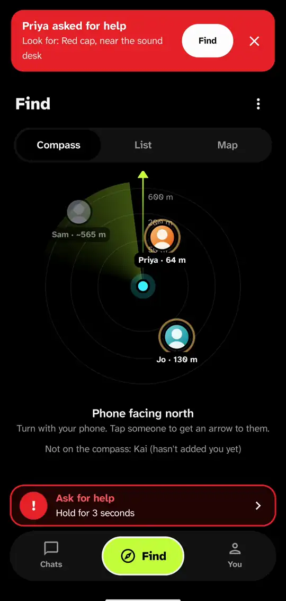
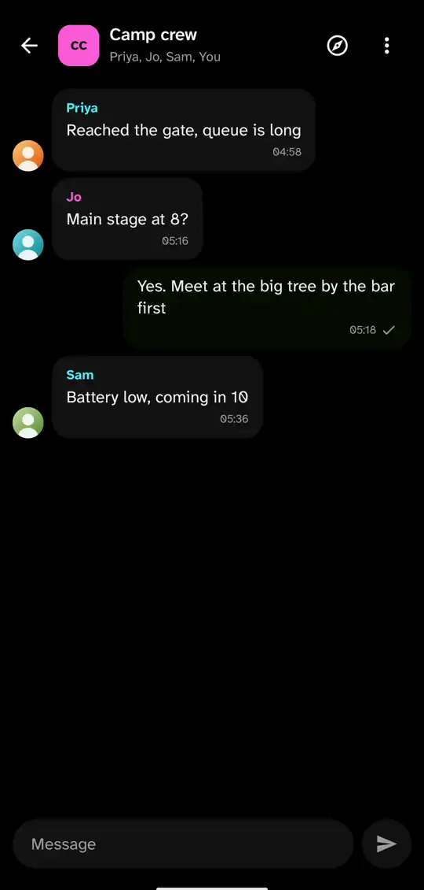

# MoshGrid

Find your friends in the crowd, even when the phone network dies.

At a big gig, thousands of phones choke the network and your group scatters. MoshGrid lets the friends you came with see where each other are, message each other and call for help, phone to phone over Bluetooth when there is no signal, and over the internet whenever there is some.

**Download for Android:** https://moshgrid.vercel.app (Android 8 and newer, free, no account)

<table>
  <tr>
    <td></td>
    <td></td>
    <td></td>
    <td></td>
  </tr>
  <tr>
    <td>Hold Help for 3 seconds</td>
    <td>Friends get an arrow to you</td>
    <td>See everyone around you</td>
    <td>Group chats, no signal needed</td>
  </tr>
</table>

## What it does

- **Find.** A compass shows your friends around you by direction and distance, turning with your phone. Tap someone for a big arrow and how far away they are. A list and a venue map are one tap away; venue maps ship inside the app, so they work with no data at all.
- **Help.** Hold the Help button for three seconds and your location, plus a note like "red cap, near the sound desk", goes to every friend. It keeps resending until it gets through and tells you who it reached. Friends get an alarm-style alert, which can sound through Do Not Disturb if they allow it.
- **Meeting points.** Drop a pin and your group gets it. Every phone that has it keeps passing it on for a while, so friends who were out of range get it when they come back.
- **Friends-only chat and groups.** Message the people you scanned, nobody else, one to one or in groups of up to 12. Ticks show who has your message and who read it; tap a message to see each person.
- **Set up before the show.** You add friends in person by scanning each other's QR code. Only people you have scanned can see your location or message you.

## How it gets messages through

Every MoshGrid phone passes messages on to the next one over Bluetooth, so a message can hop across the crowd to a friend out of direct range. When any phone has internet, messages also go through MoshGrid's own Nostr relay, end-to-end encrypted, so the relay cannot read them. Sharing your location and using the internet can each be turned off in settings.

Honest limits: Bluetooth reaches roughly across a large room between two phones, it works best when there are other MoshGrid phones in between, iPhone isn't supported yet, and MoshGrid is not an emergency service. In danger, find venue staff or call 112.

## MoshGrid and bitchat

MoshGrid is a fork of [bitchat-android](https://github.com/permissionlesstech/bitchat-android). We didn't build the mesh: the Bluetooth mesh, the Noise encryption and the Nostr transport all come from bitchat, and they are most of the code in this repository. bitchat's authors deserve the credit for that part.

The app built on top of it is a different product:

| | bitchat | MoshGrid |
|---|---|---|
| Who you talk to | Anyone nearby, often strangers, in public rooms and location channels | Only friends you scanned in person |
| What it's for | Open, anonymous chat | Finding your group at a gig and getting help |
| Main screen | Chat | A map of the venue with your friends on it |
| Getting help | Not a feature | Hold-to-send Help that retries until friends get it and says who did |
| Location | Coarse location channels shared with everyone in them | Your exact spot, shared only with your friends |

What MoshGrid adds: Find with offline venue maps, friend location sharing, Help with retries and delivery status, meeting points, QR-only friends, a new four-tab interface, and battery guidance for keeping the app running all show (the `mosh` and `ui/mosh` packages).

What MoshGrid hides or removes from bitchat: public mesh chat, location channels and the globe, voice notes, photos and files, Cashu payments and Tor. Phones still relay other MoshGrid phones' encrypted packets, so everyone in the crowd helps carry messages.

## Build

Requires JDK 21 and the Android SDK versions in `gradle/libs.versions.toml`.

```sh
./gradlew :app:assembleDebug
./gradlew testDebugUnitTest
```

Release builds are signed with a key that is not in this repository. Crash reporting is off unless you build with `-PsentryDsn=...`, and in the app it is on by default: the switch is shown during setup, nothing is sent before setup ends, and it can be turned off any time in You. See `AGENTS.md` for project conventions and `docs/` for protocol specs and the release guide.

## Verify a download

The website lists the SHA-256 of each APK and of the signing certificate. Compare them with:

```sh
shasum -a 256 MoshGrid-1.0.0.apk
apksigner verify --print-certs MoshGrid-1.0.0.apk
```

## Licence

MoshGrid is free software under the GNU General Public License v3, the same licence as bitchat-android. See `LICENSE.md` and `NOTICE`.
